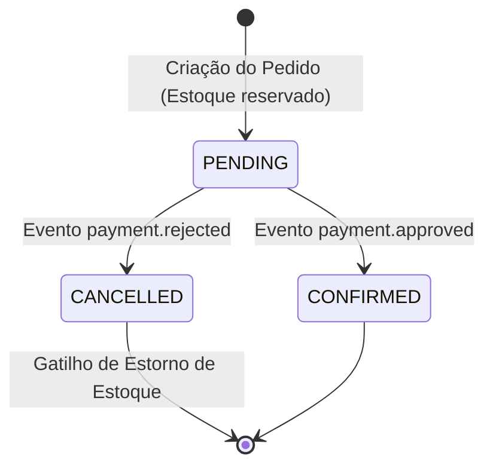
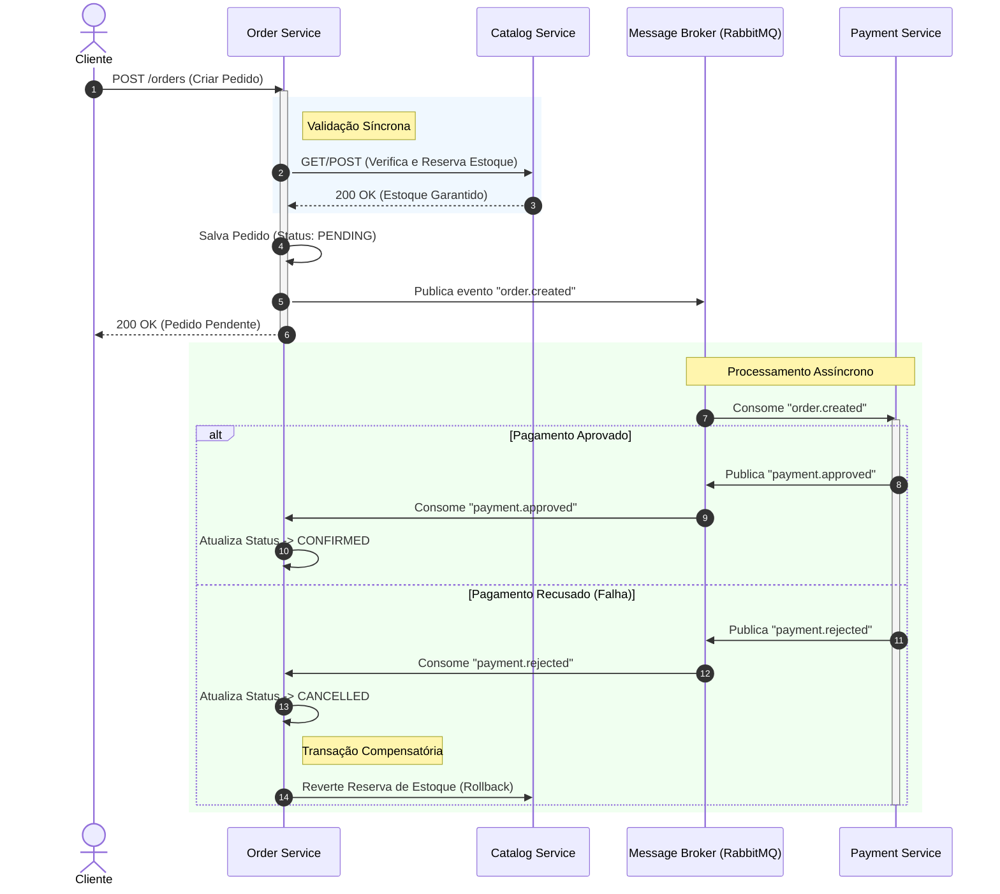

# Estratégia de Consistência e Gerenciamento de Transações

Este documento formaliza as decisões arquiteturais relacionadas à consistência de dados, fluxo de transações distribuídas e comportamento do sistema diante de falhas na arquitetura de microsserviços do e-commerce.

## 1. O Problema do 2PC e a Escolha pela Consistência Eventual

Em arquiteturas distribuídas, a adoção de transações globais baseadas em ACID clássico (como o *Two-Phase Commit* - 2PC) impõe gargalos críticos de escalabilidade. O 2PC exige *locks* distribuídos nos bancos de dados de múltiplos serviços (ex: Catálogo, Pedidos e Pagamentos) simultaneamente. Isso acopla os serviços no tempo, aumenta a latência da resposta ao cliente e cria um ponto único de falha: se um serviço fica indisponível, a transação inteira trava.

Para garantir alto desempenho e desacoplamento, este sistema adota o modelo de **Consistência Eventual**. O sistema aceita que, por curtos períodos, os dados entre os microsserviços possam estar defasados (ex: um pedido criado, mas o pagamento ainda em processamento), garantindo que, através de eventos e reconciliações, todos os serviços convirjam para um estado consistente no futuro.

## 2. Teorema CAP: Mapeamento AP

Diante do Teorema CAP (Consistência, Disponibilidade e Tolerância a Partição), a nossa arquitetura prioriza **AP (Alta Disponibilidade e Tolerância a Partição de Rede)**.

Em um contexto de e-commerce, é estrategicamente mais vantajoso aceitar o pedido do cliente (Disponibilidade) mesmo que o serviço de pagamento ou o broker de mensagens sofra uma oscilação temporária de rede (Partição). A consistência estrita (C) é sacrificada no momento imediato da requisição em prol de não bloquear o fluxo de vendas, delegando a sincronização final para o processamento assíncrono em background.

## 3. Padrão SAGA Coreografado

Para coordenar as operações que cruzam as fronteiras dos microsserviços sem utilizar um orquestrador central (o que criaria um acoplamento indesejado), utilizamos o padrão **SAGA Coreografado**. 

Neste modelo, não há um "serviço mestre" ditando o fluxo. Cada microsserviço reage a eventos de domínio publicados no *Message Broker* (RabbitMQ) e publica novos eventos ao finalizar seu trabalho.

### 3.1. Fluxo Principal (Sucesso)
1. O cliente envia a requisição de compra para o `order-service`.
2. O `order-service` faz uma validação **síncrona** de estoque no `catalog-service`. Se houver estoque, ele é temporariamente reservado.
3. O `order-service` persiste o pedido no banco com o status `PENDING` e publica o evento `order.created` no broker.
4. O `payment-service` (assincronamente) consome o evento e processa a cobrança.
5. Em caso de sucesso, o `payment-service` publica o evento `payment.approved`.
6. O `order-service` consome o evento e evolui o status do pedido para `CONFIRMED`.

### 3.2. Fluxo de Falha e Transações Compensatórias
Se a cobrança falhar, o sistema não pode simplesmente "dar rollback" no banco de dados, pois o estoque já foi alterado em outro microsserviço. Utilizamos uma **Transação Compensatória**:
1. O `payment-service` detecta a recusa (ou fraude) e publica o evento `payment.rejected`.
2. O `order-service` consome o evento e altera o status do pedido para `CANCELLED`.
3. O `order-service` dispara uma ação compensatória (via HTTP ou mensageria) para o `catalog-service`, instruindo o **estorno da reserva no estoque**.

---

## 4. Diagramas de Arquitetura

### 4.1. Máquina de Estados do Pedido

### 4.2. Diagrama de Sequência da SAGA Coreografada

